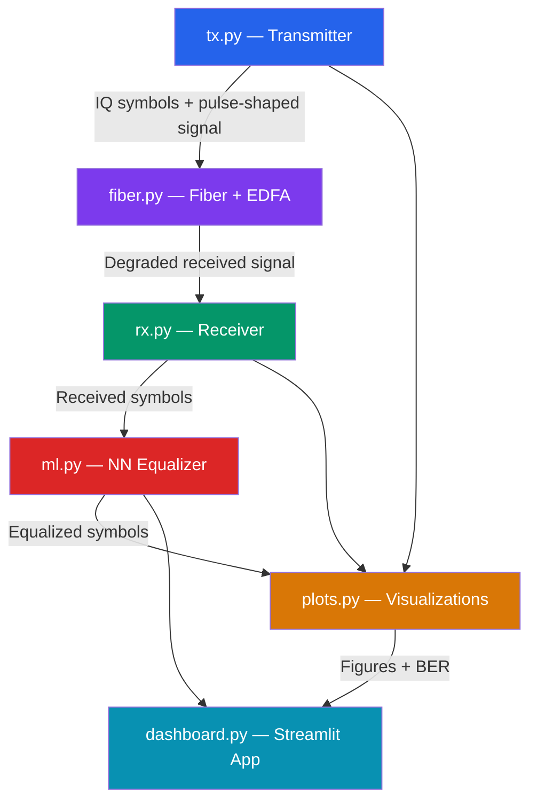
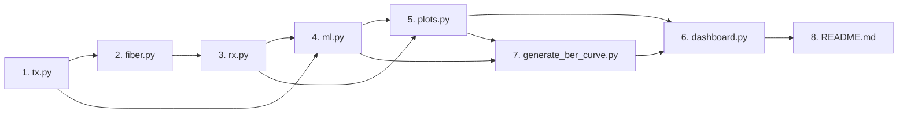

# Implementation Plan
## AI-Based Impairment Compensation for High-Speed Optical Communication Links

> Based on [TRD_AI_Optical_Link_Compensation.md](file:///D:/7th%20sem%20Project/TRD_AI_Optical_Link_Compensation.md) — B.Tech (ECE) Final-Year Simulation Project

---

## Goal Description

Build a **Python simulation** of a high-speed fiber-optic communication link that:
1. Models signal propagation through fiber (dispersion, Kerr nonlinearity, EDFA amplifier noise) using the **Split-Step Fourier Method (NLSE)**.
2. Demonstrates signal degradation via **eye diagrams** and **constellation diagrams**.
3. Trains a **lightweight fully-connected neural network equalizer** on simulated data and measures BER improvement.
4. Exposes results through an **interactive Streamlit dashboard** with live sliders.

The deliverables are: Python source code, trained model, result plots, dashboard, README.

---

## User Review Required

> [!IMPORTANT]
> **Framework Choice — PyTorch vs TensorFlow:** The TRD lists both. The plan below uses **PyTorch** (more common in research, easier to debug). Please confirm or request a switch to TensorFlow.

> [!IMPORTANT]
> **Dashboard Framework — Streamlit vs Plotly Dash:** The TRD lists both. The plan uses **Streamlit** (simpler single-file setup, single command to launch). Please confirm or request Dash instead.

> [!WARNING]
> **Simulation Performance:** A full SSFM run over 1000 km (12 spans) with 32 GBd symbols can be slow on CPU. The plan uses a **reduced symbol count for the live dashboard** (≈1024 symbols) and a **larger count for offline training** (≈16 384 symbols). If the dashboard feels slow, the symbol count will be tuned down further.

> [!NOTE]
> **OptiSystem Cross-check:** The TRD lists this as optional and only if available in the department. It is **excluded** from this plan. If you have OptiSystem access and want a validation step, let me know.

---

## Open Questions

> [!IMPORTANT]
> 1. **Modulation default:** Should the dashboard open on **QPSK** (simpler, easier to demonstrate) or **16-QAM**? Plan: QPSK as default, 16-QAM selectable.
> 2. **Equalizer output type:** The TRD notes "regression vs classification outputs are compared in [3]." Plan: use **regression (MSE loss on IQ coordinates)** as default. Should we also implement the classification variant for comparison?
> 3. **BER vs Distance curve:** This requires running the simulation multiple times at different distances. Plan: **pre-compute and cache** this curve offline (a script `generate_ber_curve.py`) rather than computing it live in the dashboard. Acceptable?
> 4. **Project folder name:** The TRD suggests `optical-link-ml/`. Since the workspace is `D:\7th sem Project\`, the plan places code in `D:\7th sem Project\optical-link-ml\`. OK?

---

## Proposed Changes

### System Architecture



---

### Folder Structure

```
D:\7th sem Project\
└── optical-link-ml\
    ├── tx.py                  # [NEW] Transmitter: bit generation, QPSK/16-QAM, pulse shaping
    ├── fiber.py               # [NEW] SSFM propagation + EDFA ASE noise
    ├── rx.py                  # [NEW] Matched filter, downsampling, demodulation, BER
    ├── ml.py                  # [NEW] Dataset builder, ANN model, training loop
    ├── plots.py               # [NEW] Eye diagrams, constellation diagrams, BER/training curves
    ├── dashboard.py           # [NEW] Streamlit interactive dashboard
    ├── generate_ber_curve.py  # [NEW] Offline script: pre-compute BER vs distance
    ├── models/                # [NEW] Saved PyTorch model weights (.pt)
    ├── results/               # [NEW] Saved figures and BER data (.png, .npy)
    └── README.md              # [NEW] Setup, parameter table, usage instructions
```

---

### Component 1 — `tx.py` (Transmitter)

**Responsibilities:** Generate random bits → map to QPSK or 16-QAM complex symbols → apply raised-cosine pulse shaping → set launch power.

```python
# Key functions
def generate_bits(n_symbols, modulation='QPSK', seed=42) -> np.ndarray
def modulate(bits, modulation='QPSK') -> np.ndarray   # returns complex IQ symbols
def pulse_shape(symbols, sps=8, rolloff=0.1) -> np.ndarray  # RRC filter, sps = samples per symbol
def set_launch_power(signal, power_dBm=0.0) -> np.ndarray
```

| Parameter | Default |
|-----------|---------|
| Symbol rate | 32 GBd |
| Samples per symbol (SPS) | 8 |
| RRC roll-off factor | 0.1 |
| Modulation | QPSK |
| Launch power | 0 dBm |

**QPSK mapping (Gray-coded):**
```
00 → (+1+1j)/√2,  01 → (-1+1j)/√2
10 → (+1-1j)/√2,  11 → (-1-1j)/√2
```

---

### Component 2 — `fiber.py` (SSFM Propagation + EDFA)

**Responsibilities:** Propagate the optical field through N fiber spans using SSFM. After each span, apply EDFA gain and add ASE noise.

#### NLSE (Split-Step Fourier Method)

```
∂A/∂z = −(α/2)A − j(β₂/2)∂²A/∂t² + jγ|A|²A
```

**SSFM per half-step `h`:**
```
Linear step (freq domain):  A_f ← FFT(A) · exp(j·β₂/2·ω²·h − α/2·h)
                             A   ← IFFT(A_f)
Nonlinear step (time domain): A ← A · exp(jγ|A|²·h)
```

**Key default parameters:**

| Parameter | Symbol | Default |
|-----------|--------|---------|
| Attenuation | α | 0.2 dB/km → 0.046 km⁻¹ |
| Dispersion | D | 17 ps/nm/km → β₂ = −21.7 ps²/km |
| Nonlinear coeff | γ | 1.3 W⁻¹km⁻¹ |
| Span length | L_span | 80 km |
| EDFA noise figure | NF | 5 dB |
| Wavelength | λ | 1550 nm |

```python
# Key functions
def ssfm_propagate(signal, fiber_params, dz=0.5) -> np.ndarray  # dz in km, step size
def edfa_amplify(signal, gain_dB, noise_figure_dB, bandwidth_Hz) -> np.ndarray
def propagate_link(signal, n_spans, span_km, fiber_params, edfa_params) -> np.ndarray
```

**EDFA ASE noise power per polarization:**
```
P_ASE = (NF_linear − 1) · G_linear · h · ν · B_ref
```
where `h` is Planck's constant, `ν` is optical frequency, `B_ref` is noise bandwidth.

---

### Component 3 — `rx.py` (Receiver)

**Responsibilities:** Apply matched RRC filter → downsample to 1 sample/symbol → phase correction (simple rotation to align constellation) → hard-decision demodulation → compute BER.

```python
# Key functions
def matched_filter(signal, sps=8, rolloff=0.1) -> np.ndarray
def downsample(signal, sps=8) -> np.ndarray
def phase_correct(symbols) -> np.ndarray        # simple 4-fold symmetry correction for QPSK
def demodulate(symbols, modulation='QPSK') -> np.ndarray   # returns bits
def compute_ber(tx_bits, rx_bits) -> float
```

---

### Component 4 — `ml.py` (Neural Network Equalizer)

**Responsibilities:** Build training/test datasets from (received, transmitted) symbol pairs. Define, train, and save the ANN. Apply the trained model to test data.

#### Dataset Construction
- **Window size:** use a sliding window of `W=5` neighbouring received symbols (real & imaginary parts separately) → input dimension = `2W = 10`.
- **Output:** 2 floats (Re, Im of the transmitted symbol).
- **Split:** 80% train / 20% test using **different random seeds** to prevent data leakage.

#### ANN Architecture

```
Input (10) → FC(64) → ReLU → FC(64) → ReLU → FC(2)
```

| Hyperparameter | Value |
|----------------|-------|
| Hidden layers | 2 |
| Hidden size | 64 |
| Activation | ReLU |
| Loss | MSE |
| Optimizer | Adam (lr = 1e-3) |
| Epochs | 100 |
| Batch size | 256 |

```python
class NNEqualizer(nn.Module):
    def __init__(self, window=5, hidden=64):
        super().__init__()
        self.net = nn.Sequential(
            nn.Linear(2 * window, hidden), nn.ReLU(),
            nn.Linear(hidden, hidden),     nn.ReLU(),
            nn.Linear(hidden, 2)
        )
    def forward(self, x): return self.net(x)

# Key functions
def build_dataset(rx_symbols, tx_symbols, window=5) -> (Tensor, Tensor)
def train(model, train_loader, val_loader, epochs=100) -> list   # returns loss history
def equalize(model, rx_symbols, window=5) -> np.ndarray          # returns equalized symbols
def save_model(model, path='models/equalizer.pt')
def load_model(path='models/equalizer.pt') -> NNEqualizer
```

---

### Component 5 — `plots.py` (Visualizations)

**Responsibilities:** Generate all static plots.

| Plot | Description |
|------|-------------|
| Eye diagram | Overlay of signal traces; before vs after compensation |
| Constellation diagram | IQ scatter: TX ideal vs RX degraded vs RX equalized |
| BER vs distance | Log-scale BER curve with/without ML; marks Q-factor limit |
| Training curve | Train & val loss vs epoch |

```python
# Key functions
def plot_eye_diagram(signal, sps, title) -> Figure
def plot_constellation(symbols_list, labels, title) -> Figure
def plot_ber_vs_distance(distances, bers_noml, bers_ml) -> Figure
def plot_training_curve(loss_history) -> Figure
```

All functions return `matplotlib.figure.Figure` objects (compatible with Streamlit's `st.pyplot()`).

---

### Component 6 — `dashboard.py` (Streamlit App)

**Responsibilities:** Interactive web UI with live simulation.

#### Layout

```
┌─────────────────────────────────────────────┐
│  🔭 Optical Link AI Equalizer Dashboard     │
├─────────────────────────────────────────────┤
│  Sidebar:                                   │
│   [Slider] Fiber Length: 80–1600 km         │
│   [Slider] Launch Power: −5 to +5 dBm       │
│   [Dropdown] Modulation: QPSK / 16-QAM      │
│   [Toggle] ML Equalizer ON/OFF              │
├─────────────────────────────────────────────┤
│  Tab 1 — Live Results                       │
│   [Constellation] [Eye Diagram]  BER: X     │
├─────────────────────────────────────────────┤
│  Tab 2 — Pre-computed Curves                │
│   [BER vs Distance] [Training Curve]        │
└─────────────────────────────────────────────┘
```

```python
# dashboard.py skeleton
import streamlit as st
from tx import generate_bits, modulate, pulse_shape, set_launch_power
from fiber import propagate_link
from rx import matched_filter, downsample, demodulate, compute_ber, phase_correct
from ml import load_model, equalize
from plots import plot_constellation, plot_eye_diagram

@st.cache_resource
def get_model(): return load_model()

# Sidebar controls
fiber_km  = st.sidebar.slider("Fiber Length (km)", 80, 1600, 400, step=80)
power_dBm = st.sidebar.slider("Launch Power (dBm)", -5, 5, 0)
modulation= st.sidebar.selectbox("Modulation", ["QPSK", "16-QAM"])
use_ml    = st.sidebar.toggle("ML Equalizer", value=True)
```

Performance note: use **N = 1024 symbols** for live dashboard runs to stay within ~2 s.

---

### Component 7 — `generate_ber_curve.py` (Offline Script)

Run once before launching dashboard. Sweeps fiber length from 80 km to 1600 km in 80 km steps, computes BER with and without the equalizer, saves results to `results/ber_curve.npy`.

```python
# Usage:
#   python generate_ber_curve.py
# Output:
#   results/ber_curve.npy  — dict with keys 'distances', 'ber_noml', 'ber_ml'
```

---

### Component 8 — `README.md`

Sections:
1. Project overview and TRD link
2. Installation (`pip install numpy scipy torch matplotlib streamlit`)
3. Quick start: train model → generate BER curve → launch dashboard
4. Parameter table (all configurable constants)
5. Folder structure
6. References

---

## Implementation Order (Dependencies First)



**Steps:**
1. `tx.py` — no dependencies
2. `fiber.py` — depends on NumPy/SciPy
3. `rx.py` — depends on `tx.py` (pulse shape params)
4. Sanity-check: run a back-to-back (no fiber) test → BER should be 0
5. `ml.py` — depends on `tx.py`, `fiber.py`, `rx.py`
6. `plots.py` — depends on all above
7. `dashboard.py` — depends on all above
8. `generate_ber_curve.py` — depends on all above
9. `README.md`

---

## Verification Plan

### Automated / Scripted Tests

| Test | Command / Script | Expected Result |
|------|-----------------|-----------------|
| Back-to-back BER | `python -c "from tx import *; from rx import *; ..."` | BER = 0.0 (no fiber impairment) |
| SSFM sanity | Check pulse broadening in time domain after 500 km | RMS width increases with distance |
| ASE noise check | EDFA with NF=5 dB, measure SNR | Matches theory: SNR ≈ (G−1)·NF |
| NN training | `python ml.py` | Loss decreases monotonically; BER improves vs no-ML baseline |
| Dashboard launch | `streamlit run dashboard.py` | Opens browser in <5 s; sliders respond in <3 s |
| BER curve script | `python generate_ber_curve.py` | Produces `results/ber_curve.npy` without errors |

### Qualitative / Manual Verification

1. **Eye diagram** — back-to-back should show a clean open eye; after 800 km should show a clearly degraded/closed eye; after ML equalization should partially reopen.
2. **Constellation** — QPSK ideal: 4 tight clusters at ±45°; after 800 km: clusters spread; after ML: clusters tighten.
3. **BER vs distance** — curve should rise (worsen) with distance; ML curve should sit below no-ML curve.
4. **Training curve** — loss should decrease and plateau; no divergence.
5. **Dashboard responsiveness** — slider movements should update all plots within ~2–3 seconds on a normal laptop.

### Deliverable Checklist (from TRD §1.6)

- [ ] `tx.py`, `fiber.py`, `rx.py`, `ml.py`, `plots.py`, `dashboard.py`
- [ ] `models/equalizer.pt` — trained model weights
- [ ] `results/` — eye diagrams, constellation plots, BER curve PNG, training curve PNG
- [ ] `README.md` — setup steps and parameter table
- [ ] Short report template (can be added if needed)

---

## Dependencies (pip install)

```bash
pip install numpy scipy torch matplotlib streamlit plotly
```

> [!TIP]
> All dependencies run on **CPU only** — no GPU required. PyTorch CPU wheel is ~200 MB.

---

## Timeline Estimate

| Phase | Files | Effort |
|-------|-------|--------|
| Transmitter + Fiber + Receiver | `tx.py`, `fiber.py`, `rx.py` | ~2 hrs |
| ML Equalizer | `ml.py` | ~1.5 hrs |
| Plots | `plots.py` | ~1 hr |
| Dashboard | `dashboard.py` | ~1 hr |
| BER curve script + README | `generate_ber_curve.py`, `README.md` | ~0.5 hr |
| Testing & tuning | — | ~1 hr |
| **Total** | | **~7 hrs** |
